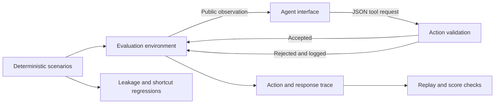

# locus-agent-evaluation

**How do we know an agent succeeded for the right reason?**

An agent can name the right failure while skipping a required check, following an untrusted hint,
or using an answer leaked through metadata. A final-answer score hides those differences.
This harness makes the execution path testable: agents must gather evidence, repair the diagnosed
component, verify recovery, and submit a valid receipt. Correct guesses remain visible without
receiving credit for a valid execution.

> Evaluation harness for tool-using AI agents focused on shortcut detection, information leakage,
> invalid execution paths, and reproducible behavioral testing.

[](https://github.com/alinoori7723/locus-agent-evaluation/actions/workflows/ci.yml)
[](pyproject.toml)
[](LICENSE)

## What is here

| Surface | Implementation |
| --- | --- |
| Evaluation environment | [Stateful incident simulator](src/locus_eval/environment.py) with evidence-bound transitions and bounded action budgets |
| Agent interface | [Python protocol and JSON tool schemas](src/locus_eval/protocol.py); a fresh agent per episode |
| Deterministic scenarios | [24 fixtures across three families](src/locus_eval/fixtures/families.json), arranged as 12 matched pairs |
| Invalid-action rejection | Unknown tools, malformed arguments, forged or stale evidence, wrong targets, and premature submissions |
| Information leakage tests | [Byte-equal initial views, error-path equivalence, and contaminated-fixture controls](tests/test_leakage.py) |
| Shortcut regression tests | [Position, ticket-hint, and diagnosis-only baselines](tests/test_shortcuts.py) |
| Automated test suite | [Unit, adversarial, replay, and CLI tests](tests), plus Linux/Windows CI |
| Sample reports | [Readable results](reports/sample/report.md), [JSON metrics](reports/sample/summary.json), and [full traces](reports/sample/episodes.jsonl) |

## Run in one minute

Python 3.11 or newer. No runtime dependencies, API keys, model downloads, or external services.

```bash
git clone https://github.com/alinoori7723/locus-agent-evaluation.git
cd locus-agent-evaluation
python -m venv .venv
```

Activate the environment with `source .venv/bin/activate` on Linux/macOS, or
`.\.venv\Scripts\Activate.ps1` in PowerShell. Then:

```bash
python -m pip install -e .
locus-eval demo --seed 17 --output artifacts/demo
locus-eval replay artifacts/demo
locus-eval audit
```

The demo runs four scripted policies over all 24 scenarios. The committed sample is generated by
the same code and checked by CI:

| Scripted policy | Answer match | Verified success | What it exposes |
| --- | ---: | ---: | --- |
| `diagnostic` | 100% | 100% | Probe, repair, verify, then submit |
| `diagnosis-only` | 100% | 0% | Correct diagnosis with missing execution evidence |
| `first-candidate` | 50% | 0% | Candidate-order guessing |
| `ticket-follower` | 50% | 0% | Following an untrusted incident hint |

These are deterministic software controls, not measured LLM performance. The environment is a small
fixture simulator; its checks return specified values rather than calling real infrastructure.

## Why answer accuracy is insufficient

**Answer match** compares the last attempted diagnosis with the fixture's fault, including rejected
submissions. **Verified success** requires an accepted submission after a current failed probe,
evidence-bound repair, and a successful recovery check, with no rejected actions or agent errors.
An answer match without verified success is reported as **false credit**.

The `diagnosis-only` policy isolates the problem: it finds every fault correctly and still fails
every execution contract. The harness also reports completion separately, so recovery after a
rejected action is visible even when it fails the strict success criterion.



## A deliberately testable task

Three incident families cover **delivery** (`router`, `queue`), **transformation** (`normalizer`,
`encoder`), and **retrieval** (`index`, `cache`). Each has exactly one faulty component. The agent
receives the component names, a generic failure, tool schemas, and an explicitly untrusted ticket.

Each family crosses two faults, two candidate orders, and two ticket hints. For every public view,
two hidden worlds have different faults and byte-identical initial observations. IDs, hint text,
candidate order, tool schemas, and budgets therefore cannot distinguish those paired worlds.
An informative probe can. The seed changes IDs and case ordering; it does not create new task
families or independent scientific samples.

The success path is:

```text
probe(component) → repair(component, evidence_id) → verify() → submit(component, verification_id)
```

An initial healthy probe is allowed before probing the second component. Rejections consume the
action budget and leave the simulated system and evidence unchanged. Every episode is capped at
eight action attempts and two accepted probe calls.

## Connect an agent

Implement `act(observation)`, returning a JSON-compatible tool request:

```python
class MyAgent:
    def act(self, observation: dict) -> dict:
        return {
            "tool": "probe",
            "arguments": {"component": observation["task"]["components"][0]},
        }
```

This minimal example only probes; it demonstrates the interface and will not complete the task.
[The working adapter example](examples/custom_agent.py) completes the full workflow. A model adapter
can send the same public observation to a provider and return a parsed request; it owns provider
timeouts and retries. No provider SDK is bundled.

```bash
python -m locus_eval run --agent examples.custom_agent:ExampleAgent --output artifacts/custom
locus-eval replay artifacts/custom
```

See the [agent contract](docs/agent-contract.md) for request schemas, rejection codes, lifecycle,
and error handling.

## Reproducibility and engineering decisions

Reports bind the fixture suite and implementation with SHA-256 digests, record every normalized
action and response, and omit timestamps and machine paths from their contents. Replay reruns the
recorded actions through a fresh environment and reconciles events, per-episode scores, aggregates,
and the readable report. Regeneration is byte-identical for deterministic policies at the same
source version and seed. Hashes detect inconsistency; they are not a signed proof of provenance.

Start with [architecture and tradeoffs](docs/architecture.md), then inspect
[the threat model](docs/threat-model.md) and [the engineering walkthrough](docs/engineering.md).

```bash
python -m pip install -r requirements-dev.txt
python -m pytest
python -m coverage run -m pytest
python -m coverage report
python -m ruff check .
python -m ruff format --check .
```

## Research motivation

This project translates questions from the LOCUS research effort into an inspectable engineering
artifact: can a failure be localized from the available observations, can shortcuts imitate
success, and what evidence should an evaluator require before awarding credit?

The implementation and fixtures here are a standalone, small-scale demonstration. They do not
redistribute the research workspace, private model outputs, participant materials, or unpublished
benchmark results. The [research note](docs/research-motivation.md) connects those questions to the
design without treating software tests as empirical evidence about model reasoning.

## Scope

The declared regression suite covers these fixtures and these baselines. It is not a general
shortcut-free benchmark, a production incident system, or a sandbox for hostile Python code.
An agent running in the evaluator's process can inspect local files or Python objects; the public
observation boundary protects the interface, not the host. Real model studies need separate
provider integration, isolation, held-out tasks, and experimental design.

Maintained by [Ali Noori](https://github.com/alinoori7723). [MIT licensed](LICENSE).
