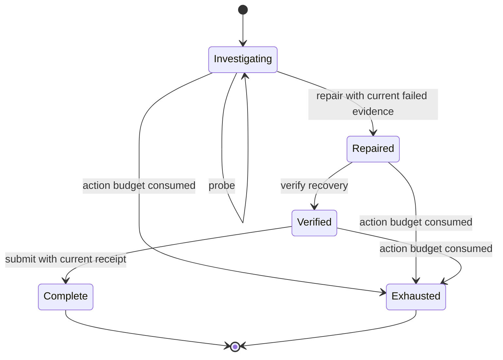

# Architecture and tradeoffs

The harness treats success as a property of a recorded interaction, not just a final string.
The runtime has no network client, database, model dependency, or shell tool.

## Data flow

1. `scenarios.build_suite(seed)` loads three fixture families and expands their complete nuisance
   cross into 24 immutable scenario records. The fault exists before any agent action.
2. `Environment` owns the fault, state revision, evidence registry, receipts, and action log.
3. `observe()` projects an explicit public payload. The runner supplies a fresh copy to `act()`;
   it never passes the environment, private case ID, or scenario object.
4. `step()` normalizes the request, validates exact fields, checks preconditions, and executes one
   allowlisted tool. Failed preconditions produce a stable error code.
5. The evaluator scores the trace and writes a report. `replay` reconstructs each environment,
   repeats recorded requests, and compares events and derived scores.

| Module | Responsibility |
| --- | --- |
| `scenarios.py` | Fixture contract, paired worlds, complete nuisance cross, stable seed behavior |
| `protocol.py` | Agent protocol, tool schemas, JSON normalization, action parsing |
| `environment.py` | State transitions, evidence validation, budgets, outcome accounting |
| `agents.py` | One positive control and three intentionally limited policies |
| `runner.py` | Fresh policy instances, terminal agent failures, per-agent aggregation |
| `audits.py` | Observation equivalence, error-channel checks, declared baseline expectations |
| `reporting.py` | Canonical artifacts, source and data fingerprints, semantic replay |
| `cli.py` | Demo, custom-agent runs, audits, and replay |

## State and evidence

A probe returns its input, expected output, measured output, pass/fail result, evidence ID, and
state revision. A repair requires an existing failed probe for the same component and revision.
Repair increments the revision, making earlier evidence stale. Verification runs after repair
and issues a new receipt; a newer verification supersedes the previous receipt. Submission checks
both the receipt and the repaired component.

Rejections leave system state and evidence unchanged. They still enter the trace and consume one
action attempt, so an agent cannot retry forever. A completed episode is immutable. Agent exceptions
terminate that episode with `agent_error`; evaluator exceptions propagate, since a harness bug must
not be mislabeled as a policy failure.

## Why a complete cross

Each family has two faults, two candidate orders, and two hints: eight worlds. Holding order and
hint fixed gives a pair with identical public input and opposite labels. With this balanced finite
construction, any deterministic policy that uses only that initial view must make the same guess
for both members and can match at most one. This argument assumes the policy has no access to
private fixtures, case ordering, previous evaluation feedback, or other side channels.

The fixture bank is deliberately small and fully inspectable. Changing the seed changes IDs and
case order, not the underlying task population. No random train/test split or generalization claim
is attached to these 24 cases.

## Reproducibility contract

- JSON uses sorted keys, a defined separator policy, ASCII escaping, and no non-finite numbers.
- Reports use UTF-8 and LF newlines. They contain no clock values or absolute machine paths.
- The suite fingerprint includes all private scenario fields in canonical form.
- The implementation fingerprint covers package Python files and fixture JSON, with normalized
  source line endings. It does not cover the interpreter, dependencies, external agent source,
  operating system, or provider responses.
- Every report file is byte-bound by `manifest.json`. Its fixed filename allowlist prevents the
  manifest from requesting arbitrary paths.
- Replay checks complete case coverage for each agent, duplicate cases, initial observations,
  every transition, termination, scores, aggregates, audits, and rendered Markdown.

Replay reuses the transition implementation; it is a consistency verifier, not a second independent
oracle. Unit tests, deliberately corrupted traces, and fixture contamination tests provide separate
checks. The manifest is unsigned and can be regenerated by anyone who can edit the files.

## Deliberate tradeoffs

| Decision | Benefit | Cost |
| --- | --- | --- |
| Standard-library runtime | Easy installation and few moving parts | No provider-specific integrations |
| Fixture-backed component checks | Exact, readable outcomes | No realistic infrastructure failures or distributed races |
| Strict zero-rejection success | Exposes invalid paths even after recovery | Harsher than a permissive task-completion metric |
| Fresh agent per case | Avoids accidental state carryover | Does not measure learning across episodes |
| In-process adapters | Small interface and easy debugging | No isolation from hostile or stalled Python code |
| Full traces and replay | Reviewable evidence of each score | Larger reports than aggregate-only evaluation |

For a production extension, process isolation and timeouts come before untrusted adapters. Real
service integrations need transactional tools and recovery semantics. Scientific evaluation needs
new held-out families and prespecified sampling beyond this finite demo.
